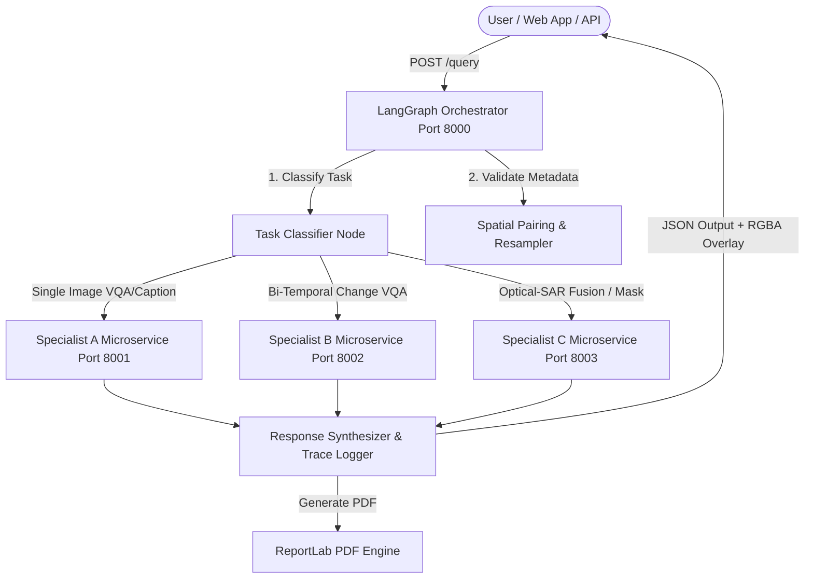

# 🚀 SatQuery AI — User & Developer Startup Guide
**Problem Statement 26167 • Smart India Hackathon (SIH 2026)**

Welcome to **SatQuery AI**, a sensor-agnostic multi-agent Earth Observation (EO) system for visual question answering, bi-temporal change detection, optical–SAR feature fusion, and automated PDF intelligence report generation.

---

## 📑 Table of Contents
1. [Prerequisites](#-prerequisites)
2. [Quick Start — 1-Click System Demonstration](#-quick-start--1-click-system-demonstration)
3. [Running the Live Production Services](#-running-the-live-production-services)
4. [Using the Web Interface](#-using-the-web-interface)
5. [Generating PDF Intelligence Reports](#-generating-pdf-intelligence-reports)
6. [Fine-Tuning & Evaluation Scripts](#-fine-tuning--evaluation-scripts)
7. [System Architecture Overview](#-system-architecture-overview)

---

## ⚙️ Prerequisites

Before launching the application, ensure your environment meets the following requirements:
- **Operating System**: Windows 10/11, Linux, or macOS.
- **GPU Recommendation**: NVIDIA GPU with CUDA support (e.g., RTX A2000 12GB or higher) for 4-bit QLoRA VLM inference. *(CPU fallback is automatically supported)*.
- **Python**: Version `3.10` or `3.11`.
- **Node.js**: Version `18+` and `npm`.

### Virtual Environment Setup
Ensure the Python virtual environment is activated:
```powershell
# Windows PowerShell
.\.venv\Scripts\activate

# Linux / macOS
source .venv/bin/activate
```

---

## ⚡ Quick Start — 1-Click System Demonstration

To verify that all components, specialists, multi-agent graph routers, spatial co-registration scripts, and PDF report generators are working correctly:

```powershell
python scripts/e2e_demo.py
```

### What this command does:
1. **Verifies Geospatial Co-registration**: Tests CRS, resolution, and bounding-box validation with bilinear reprojection fallback.
2. **Loads Benchmark Datasets**: Validates VRSBench, RSVQA-LR, CDVQA+SECOND, and BigEarthNet-MM loaders.
3. **Executes Specialist C**: Runs joint Optical-SAR encoding and 6-class bi-temporal segmentation.
4. **Triggers LangGraph Orchestrator**: Routes multi-modal queries to specialized agents and computes execution traces.
5. **Generates PDF Report**: Builds `reports/SatQuery_E2E_Intelligence_Report.pdf`.
6. **Verifies Frontend**: Validates the production Vite build (`frontend/dist/index.html`).

---

## 🌐 Running the Live Production Services

SatQuery AI operates as a microservice architecture orchestrated by a central LangGraph state machine.

### Step 1: Launch Specialist Microservices (Terminals 1, 2 & 3)

Open 3 terminal windows and start each specialist service:

```powershell
# Terminal 1 — Specialist A (Optical VQA & Captioning) [Port 8001]
python services/vqa_service/main.py

# Terminal 2 — Specialist B (Bi-Temporal Change-VQA) [Port 8002]
python services/changevqa_service/main.py

# Terminal 3 — Specialist C (Optical-SAR Fusion & Segmentation) [Port 8003]
python services/fusion_service/main.py
```

### Step 2: Launch LangGraph Multi-Agent Orchestrator (Terminal 4)

In a 4th terminal, start the main multi-agent API router:

```powershell
# Terminal 4 — Multi-Agent Orchestrator [Port 8000]
python orchestrator/main.py
```

### Step 3: Launch n8n Webhook Proxy (Optional - Terminal 5)

If you want to use the industrial n8n webhook front door:

```powershell
# Terminal 5 — n8n Webhook Proxy [Port 5678]
python n8n/mock_n8n_server.py
```

### Step 4: Launch Frontend Web Application (Terminal 6)

In a 6th terminal, navigate to the `/frontend` directory and start the Vite development server:

```powershell
cd frontend
npm run dev
```

Open your browser and navigate to **`http://localhost:5173`**.

---

## 🖥️ Using the Web Interface

The SatQuery AI Web Application is designed with a sleek dark-mode glassmorphism theme for Earth Observation intelligence analysts.

### 1. Image Upload Zone (Dual Mode)
- **Single Image Mode**: Drag & drop or click to upload **1 satellite image**. Used for general VQA, object count, land cover captioning, and bounding box grounding.
- **Bi-Temporal Pair Mode**: Upload **2 satellite images** (Pre-Change / Time 1 and Post-Change / Time 2). Used for change detection, infrastructure analysis, and surface transformation mapping.

### 2. Demo Presets & Suggestion Chips
- Use the quick preset buttons to load sample imagery:
  - 🏗️ **Building Construction Change**
  - 🌲 **Forest & River Analysis**
  - 🏙️ **Urban Infrastructure Count**
- Click prompt chips or type your natural language question in English.

### 3. Interactive Results Panel
Upon submitting a query, the UI displays:
- **Analytical Answer Card**: Concise executive response synthesized by the specialized VLM.
- **Visual Change Overlay**: High-resolution 6-class segmentation overlay with color-coded legend:
  - 🟩 **Green**: Forest / Vegetation
  - 🟦 **Blue**: Water Bodies
  - 🟨 **Yellow**: Agriculture
  - 🟥 **Red**: Urban / Infrastructure
  - 🟫 **Brown**: Bareland
- **Confidence Metric**: Color-coded confidence badge (e.g., `91.0% Confidence`).
- **Auditable Execution Trace Accordion**: Expandable breakdown detailing:
  - Task Classification (`CHANGE_VQA`, `VQA`, `GROUNDING`, `FUSION`)
  - Specialists Invoked (`Specialist B`, `Specialist C`)
  - Processing Latency in milliseconds
  - Geospatial CRS & Resolution Validation Log

---

## 📄 Generating PDF Intelligence Reports

To compile an official, publication-ready Earth Observation Intelligence Report containing executive summaries, dual imagery, visual segmentation overlays, and full execution traces:

```powershell
python reports/generate.py
```

The compiled PDF will be saved to:
`reports/SatQuery_E2E_Intelligence_Report.pdf`

---

## 🧪 Fine-Tuning & Evaluation Scripts

If you wish to fine-tune the specialist models or re-evaluate them on benchmark test splits:

### Specialist A (Optical VQA & Captioning)
```powershell
# Train QLoRA adapter on VRSBench + RSVQA-LR
python finetune/specialist_a/train_specialist_a.py --samples 50 --epochs 3 --batch_size 2

# Evaluate on test split
python finetune/specialist_a/eval_specialist_a.py --samples 50
```

### Specialist B (Bi-Temporal Change-VQA)
```powershell
# Train QLoRA adapter on CDVQA + SECOND
python finetune/specialist_b/train_specialist_b.py --samples 50 --epochs 3 --batch_size 2

# Evaluate on CDVQA test split
python finetune/specialist_b/eval_specialist_b.py --samples 50
```

### Specialist C (Fusion & 6-Class Segmentation)
```powershell
# Train contrastive encoder & U-Net segmentation head
python finetune/specialist_c/train_specialist_c.py --epochs 5

# Evaluate segmentation accuracy
python finetune/specialist_c/eval_specialist_c.py
```

---

## 🗺️ System Architecture Overview



---

## 🤝 Troubleshooting & Support
- **CUDA Out of Memory**: Lower `--batch_size` to `1` in fine-tuning scripts. 4-bit NF4 quantization requires ~2.2GB VRAM per model.
- **Port Conflict**: If port 8000, 8001, 8002, or 8003 is in use, modify the port number in the respective `main.py` file.
- **Rasterio CRS Warning**: `pairing.py` automatically handles coordinate reprojection when images differ in CRS or resolution.

Enjoy analyzing Earth Observation data with **SatQuery AI**! 🌍📡
